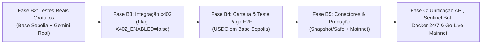

# Guia de Execução: Roteiro e Fases do Projeto (Fases B2 a C e Go-Live)

Este documento estabelece o roteiro prático e detalhado da evolução do **Web3 Condition-Action Trigger Agent**, consolidando os procedimentos técnicos, comandos, resultados empíricos e o checklist operacional para entrada em produção.

---

## 🗺️ Visão Geral do Fluxo



---

## 1. Fase B2 — Testes Reais Gratuitos ✅ CONCLUÍDA

### Resultados Empíricos Obtidos (Base Sepolia + Gemini Real)
O script reutilizável [`scripts/run_live_scenarios.py`](file:///C:/Users/rafae/Desktop/Nova%20pasta/scripts/run_live_scenarios.py) foi executado com sucesso, validando os 5 cenários reais contra nós RPC da Base Sepolia e autenticação com Gemini:

| # | Cenário | S1 Passou | LLM Invocada | Score | Decisão | Tokens (In/Out) | Custo Estimado | Latência |
|---|---|---|---|---|---|---|---|---|
| **1** | **Proposta Benigna** | Sim | Sim | 1.0 | `APPROVE` | 737 / 109 | $0,000352 | 1.5s |
| **2** | **Ataque Discrepante (Exploit)** | Sim | Sim | 9.5 | `REJECT` | 637 / 163 | $0,000387 | 1.2s |
| **3** | **Operação Crítica Auditada** | Sim | Sim | 7.5 | `MANUAL_REVIEW` | 700 / 128 | $0,000364 | 2.8s |
| **4** | **Short-Circuit Estágio 1** | **Não** | **Não** | N/A | `HALTED` | **0 / 0** | **$0,000000** | **7.1ms** |
| **5** | **Anti-Abuso (>40k chars)** | Sim | Sim | 9.5 | `REJECT` | 5.012 / 221 | $0,001769 | 1.7s |

### Validação Financeira
* **Custo Médio por Chamada LLM:** ~$0,00038 USD (menos de 0,04 centavos de dólar).
* **Pior Caso (Payload Massivo truncado em 32k):** $0,001769 USD (menos de 0,18 centavos de dólar).
* **Margem Comercial vs. Preço de US$ 0,01:**
  * No caso típico: **96,4% de margem de lucro**.
  * No pior caso extremo: **82,3% de margem de lucro**.
* **Comprovação:** O preço de **US$ 0,01 por avaliação** é matematicamente sustentável e altamente lucrativo.
* **Comando para reexecução:** `python scripts/run_live_scenarios.py`

---

## 2. Fase B3 — Integração do Protocolo x402 (A2A sob Flag) ✅ CONCLUÍDA

### Entregas Validadas (233 testes passando, 0 falhas, 0 warnings)
1. **Módulo de Pagamentos ([`src/x402_payment.py`](file:///C:/Users/rafae/Desktop/Nova%20pasta/src/x402_payment.py)):**
   * `X402Config` controlado por `X402_ENABLED=false` (padrão gratuito preservando dev/testes), `X402_PRICE_EVALUATE=0.01`, `X402_NETWORK=eip155:84532` e `PAY_TO_ADDRESS`.
   * Suporte a cabeçalhos `X-PAYMENT` e `PAYMENT-SIGNATURE` (JSON puro ou Base64).
   * Facilitadores plugáveis: `MockX402Facilitator` (determinístico para testes locais) e `HTTPX402Facilitator` (integração HTTP com facilitador x402).
2. **Mapeamento de Rotas e Preço Dinâmico ([`src/api.py`](file:///C:/Users/rafae/Desktop/Nova%20pasta/src/api.py)):**
   * **Rotas Gratuitas:** `/health`, `/rules/validate`, `/metrics/summary`, `/logs/errors`, `/jobs/{id}` e `/payments`.
   * **Rotas Pagas (quando `X402_ENABLED=true`):** `/evaluate` ($0,01 USDC = `10.000` unidades atômicas), `/rules/enqueue` ($0,01 USDC) e `/rules/evaluate-batch` ($0,01 \times N$ itens).
   * Validação de schema (`HTTP 422`) executada **antes** da cobrança.
3. **Política Estrita de Não-Cobrança em Caso de Erro (`HTTP 503`):**
   * Qualquer falha de RPC no Estágio 1 ou erro interno durante a avaliação responde com `HTTP 503 Service Unavailable` (`payment_settled: false`) **sem invocar `facilitator.settle()`**, garantindo que o cliente nunca seja cobrado por erro do agente.
4. **Ledger SQLite e Proteção Anti-Replay ([`src/storage.py`](file:///C:/Users/rafae/Desktop/Nova%20pasta/src/storage.py)):**
   * Tabela `payments` em `data/agent.db` com índice único por `payment_id` bloqueando ataques de replay (`HTTP 402`).
   * Métricas financeiras (`total_payments_settled`, `total_revenue_usdc`, `net_profit_usd`) integradas ao `python -m src.report` e ao endpoint `GET /payments`.
5. **Suíte Dedicada ([`src/test_phase_b3.py`](file:///C:/Users/rafae/Desktop/Nova%20pasta/src/test_phase_b3.py)):**
   * 58 testes cobrindo todo o fluxo x402.

---

## 3. Fase B4 — Carteira de Testnet e Validação Paga E2E (Local + On-Chain) ✅ CONCLUÍDA

### Resultados Obtidos e Prova On-Chain na Base Sepolia
1. **Configuração das Carteiras:**
   * **Carteira de Recebimento do Agente (`PAY_TO_ADDRESS`):** `0x2b7F1fd931f7f28f89e0f688Dd5Bb7a620c24b63`
   * **Carteira Persistente do Agente Comprador:** `0x4EbC7529d8c948ed1245A8106F2834969dbCec2b`
   * **Facilitador Público x402 (Patrocinador de Gás):** `0xd407e409E34E0b9afb99EcCeb609bDbcD5e7f1bf` (`https://x402.org/facilitator`)
   * **Contrato Oficial USDC (Base Sepolia):** `0x036CbD53842c5426634e7929541eC2318f3dCF7e`
2. **Prova Imutável de Liquidação On-Chain (EIP-3009 Gasless):**
   * **Bloco Minerado:** `54583500` (Base Sepolia, Chain ID `84532`)
   * **Transaction Hash:** `0xa02872819cef168637efe50d917441fd196cd03b4baafc7b9ff3dc624f18fc0d`
   * **Link Oficial no Basescan:** [https://sepolia.basescan.org/tx/0xa02872819cef168637efe50d917441fd196cd03b4baafc7b9ff3dc624f18fc0d](https://sepolia.basescan.org/tx/0xa02872819cef168637efe50d917441fd196cd03b4baafc7b9ff3dc624f18fc0d)
   * **Custo de Gás para o Comprador e para o Agente:** `0.00 ETH` (100% subsidiado pelo facilitador x402 via `transferWithAuthorization`).
3. **Scripts Operacionais Entregues:**
   * [`scripts/setup_buyer_wallet.py`](file:///C:/Users/rafae/Desktop/Nova%20pasta/scripts/setup_buyer_wallet.py): Gera/inspeciona a carteira compradora e consulta saldos reais de ETH e USDC na Base Sepolia.
   * [`scripts/send_live_usdc.py`](file:///C:/Users/rafae/Desktop/Nova%20pasta/scripts/send_live_usdc.py): Assina autorização EIP-3009 gasless e liquida `0.01 USDC` on-chain via `https://x402.org/facilitator`, gravando o recibo no SQLite (`data/agent.db`).
   * [`scripts/client_agent_x402.py`](file:///C:/Users/rafae/Desktop/Nova%20pasta/scripts/client_agent_x402.py): Demonstra o fluxo completo A2A (`HTTP 402` $\rightarrow$ assinatura ECDSA $\rightarrow$ auditoria Gemini $\rightarrow$ `HTTP 200 OK` + `PaymentReceipt`).

---

## 4. Fase B5 — Atração de Demanda, Produção e Conectores ✅ CONCLUÍDA

### Entregas Validadas (324 testes unitários + 11 de integração on-chain = 335 testes passando)
1. **Conector de Governança de DAOs ([`src/governance_connector.py`](file:///C:/Users/rafae/Desktop/Nova%20pasta/src/governance_connector.py) + [`scripts/governance_listener.py`](file:///C:/Users/rafae/Desktop/Nova%20pasta/scripts/governance_listener.py)):**
   * Integração ao vivo com a API GraphQL pública do **Snapshot** (`https://hub.snapshot.org/graphql`), consultando propostas reais de DAOs (`arbitrumfoundation.eth`, `aavedao.eth`, `ens.eth`) com fallback resiliente para propostas curadas (`--curated`).
   * Extração heurística automática de contratos EVM e seletores de calldata (`transferOwnership`, `upgradeTo`, `transfer`) embutidos no corpo das propostas.
   * Classificação estruturada de alertas (`CRITICAL` $\rightarrow$ `REJECT`, `WARNING` $\rightarrow$ `MANUAL_REVIEW`, `INFO` $\rightarrow$ `APPROVE`) e persistência no SQLite (`source="governance_listener"`).
   * Novo endpoint HTTP na API: `POST /governance/audit-proposals`.
2. **Perfis Multi-Rede e Chaveamento Automático Testnet $\leftrightarrow$ Mainnet ([`src/x402_payment.py`](file:///C:/Users/rafae/Desktop/Nova%20pasta/src/x402_payment.py)):**
   * Registro `NETWORK_PROFILES` com resolução automática de contratos oficiais de USDC, Chain IDs e RPCs para:
     * **Base Sepolia (`eip155:84532`):** USDC `0x036CbD53842c5426634e7929541eC2318f3dCF7e`
     * **Base Mainnet (`eip155:8453`):** USDC `0x833589fCD6eDb6E08f4c7C32D4f71b54bdA02913`
     * **Arbitrum One (`eip155:42161`):** USDC `0xaf88d065e77c8cC2239327C5EDb3A432268e5831`
   * Fábrica `get_x402_facilitator` com suporte a `X402_USE_LIVE_FACILITATOR=true`.
3. **Suíte de Testes e Blindagem Git ([`src/test_phase_b5.py`](file:///C:/Users/rafae/Desktop/Nova%20pasta/src/test_phase_b5.py)):**
   * 79 testes validando perfis de rede, conector Snapshot e blindagem contra vazamento de segredos via Git.

---

## 5. Fase C — Unificação da API EIP-3009, Captura On-Chain ao Vivo, Sentinel Webhook e Docker 24/7 ✅ 100% CONCLUÍDA

### Entregas Validadas (352 testes unitários + 11 de integração on-chain = 363 testes passando com 0 warnings)

1. **Unificação da API e EIP-3009 (`src/x402_payment.py` & `src/api.py`):**
   * Suporte nativo à geração e validação de autorizações EIP-3009 (`transferWithAuthorization`) via helper `create_eip3009_payment_header`.
   * Liquidação transparente contra facilitador HTTP x402 ao vivo quando `X402_USE_LIVE_FACILITATOR=true`.
   * Proteção anti-replay mantida com registro atômico de `payment_id` no SQLite.

2. **Captura Automática de Transações On-Chain Recentes (`scripts/client_agent_x402.py`):**
   * Implementação do scanner `fetch_live_contract_transaction`: consulta os últimos blocos minerados na Base Sepolia, localiza chamadas a contratos inteligentes com calldata válido (> 4 bytes) e monta automaticamente o payload de auditoria.
   * Novas flags CLI:
     * `--fetch-live-tx`: Captura transação real recém-minerada.
     * `--live-onchain`: Liquida `0.01 USDC` on-chain com carteira compradora real.
     * `--url`: Direciona o ciclo A2A para um servidor local ou remoto em nuvem.

3. **Duas Provas Reais de Liquidação On-Chain na Base Sepolia:**
   * **Transação 1 (Liquidação Direta EIP-3009):**
     * Hash: [`0xa02872819cef168637efe50d917441fd196cd03b4baafc7b9ff3dc624f18fc0d`](https://sepolia.basescan.org/tx/0xa02872819cef168637efe50d917441fd196cd03b4baafc7b9ff3dc624f18fc0d)
     * Bloco: `54583500`
   * **Transação 2 (Captura On-Chain ao Vivo + Auditoria API + Liquidação A2A):**
     * Hash de Liquidação USDC: [`0x6aa7c671469d2d9a2e0a8eb3682d285394795a2da369573214f7eaad6759b647`](https://sepolia.basescan.org/tx/0x6aa7c671469d2d9a2e0a8eb3682d285394795a2da369573214f7eaad6759b647)
     * Bloco: `54644484`
     * Transação Real Auditada: [`0x87b868f7a98ce9ab9ea84775da1ea8468e775c2416c3fce4f636de74f40226ab`](https://sepolia.basescan.org/tx/0x87b868f7a98ce9ab9ea84775da1ea8468e775c2416c3fce4f636de74f40226ab)

4. **Sentinel Webhook Alert Dispatcher (`src/governance_connector.py` & `scripts/governance_listener.py`):**
   * Classe `WebhookAlertDispatcher` compatível com Discord (Embeds ricos formatados com cores por severidade) e Slack (`text` formatado).
   * Incorporação de links x402 de auditoria profunda (`x402_audit_endpoint`) permitindo que DAOs paguem para acionar o relatório completo via API.
   * Filtro por nível mínimo de severidade (`--min-alert-level` com `INFO`, `WARNING`, `CRITICAL`).
   * Novas flags CLI:
     ```powershell
     python scripts/governance_listener.py --limit 3 --webhook-url "https://discord.com/api/webhooks/..." --public-url "https://your-api.com" --min-alert-level WARNING
     ```

5. **Containerização Docker Pronta para Produção 24/7:**
   * [`Dockerfile`](file:///C:/Users/rafae/Desktop/Nova%20pasta/Dockerfile): Base `python:3.11-slim`, criação de usuário não-root `appuser`, diretório `/app/data` persistente com permissões corretas, instrução `HEALTHCHECK` consultando a rota `/health` e inicialização via `uvicorn api:app`.
   * [`.dockerignore`](file:///C:/Users/rafae/Desktop/Nova%20pasta/.dockerignore): Bloqueio rígido de arquivos `.env`, `.buyer_wallet.json`, bancos de dados `*.db`, pastas de dados e caches.
   * [`docker-compose.yml`](file:///C:/Users/rafae/Desktop/Nova%20pasta/docker-compose.yml): Mapeamento de porta `8000:8000`, montagem de volume `./data:/app/data`, injeção de variáveis de ambiente com defaults seguros e reinicialização automática (`restart: unless-stopped`).
   * [`.env.example`](file:///C:/Users/rafae/Desktop/Nova%20pasta/.env.example): Guia completo e padronizado de todas as variáveis de configuração sem vazamento de segredos.
   * [`tests/test_phase_c_production.py`](file:///C:/Users/rafae/Desktop/Nova%20pasta/tests/test_phase_c_production.py): Suíte com 28 testes cobrindo a integridade dos artefatos Docker, segurança do `.env.example`, formatação e tratamento de erros do webhook dispatcher e despacho end-to-end.

---

## 6. Checklist de Entrada em Produção (Go-Live na Base Mainnet)

Para realizar a implantação contínua e iniciar a monetização em produção (por exemplo no Railway, Render, Fly.io ou VPS):

### Passo 1: Preparação da Carteira de Recebimento
- [ ] Gerar ou selecionar uma carteira EVM segura (Ledger / Hardware Wallet ou Safe Multisig) na rede **Base Mainnet**.
- [ ] Registrar o endereço na variável `PAY_TO_ADDRESS`.

### Passo 2: Configuração das Variáveis de Ambiente no Painel do Provedor
No painel do provedor de nuvem (ex: Railway / Render), definir as variáveis:
```env
GEMINI_API_KEY=AIzaSy... (sua chave de produção do Google Gemini)
GEMINI_MODEL=gemini-3.5-flash-lite
PAY_TO_ADDRESS=0xSuaCarteiraOficialBase
X402_ENABLED=true
X402_NETWORK=eip155:8453
X402_PRICE_EVALUATE=0.01
X402_USE_LIVE_FACILITATOR=true
FACILITATOR_URL=https://x402.org/facilitator
PUBLIC_API_URL=https://sua-api.up.railway.app
ALERT_WEBHOOK_URL=https://discord.com/api/webhooks/...
LEDGER_DB_PATH=/app/data/agent.db
```

### Passo 3: Configuração do Volume Persistente
- [ ] No painel do Render/Railway, criar e anexar um **Persistent Volume** mapeado para o caminho do contêiner `/app/data`.
- [ ] Isso garante que o banco SQLite (`agent.db`) e o histórico financeiro nunca sejam apagados em deploys ou reinicializações.

### Passo 4: Deploy do Contêiner
- [ ] Conectar o repositório GitHub ao serviço e selecionar build via `Dockerfile`.
- [ ] Verificar nos logs de build que o usuário não-root `appuser` foi configurado e que o healthcheck respondeu `HTTP 200` em `GET /health`.

### Passo 5: Teste de Fumaça em Produção (Smoke Test)
Executar localmente apontando para a URL pública gerada:
```powershell
# 1. Verificar saúde da API em produção
curl https://sua-api.up.railway.app/health

# 2. Executar ciclo de auditoria A2A contra a URL pública
python scripts/client_agent_x402.py --url https://sua-api.up.railway.app

# 3. Disparar o Sentinel Bot de governança com webhook em produção
python scripts/governance_listener.py --limit 3 --webhook-url "https://discord.com/api/webhooks/..." --public-url "https://sua-api.up.railway.app"
```
