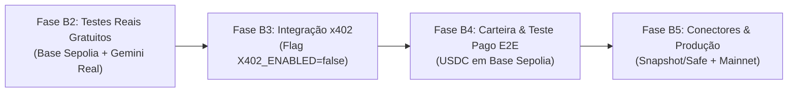

# Guia de Execução: Próximas Etapas (Fases B2 a B5)

Este documento estabelece o roteiro prático e detalhado para a execução das próximas etapas do **Web3 Condition-Action Trigger Agent**, consolidando os procedimentos técnicos, comandos e responsabilidades para cada fase.

---

## 🗺️ Visão Geral do Fluxo



---

## 1. Fase B2 — Testes Reais Gratuitos ✅ CONCLUÍDA

### Resultados Empíricos Obtidos (Base Sepolia + Gemini Real)
O script reutilizável [`scripts/run_live_scenarios.py`](file:///C:/Users/rafae/Desktop/Nova%20pasta/scripts/run_live_scenarios.py) foi executado com sucesso, validando os 5 cenários reais contra nós RPC da Base Sepolia e autenticação com Gemini:

| # | Cenário | S1 Passou | LLM Invocada | Score | Decisão | Tokens (In/Out) | Custo Estimado | Latência |
|---|---|---|---|---|---|---|---|---|
| **1** | **Proposta Benigna** | Sim | Sim | 1.0 | `APPROVE` | 737 / 109 | $0,000352 | 1.5s |
| **2** | **Ataque Discrepante (Exploit)** | Sim | Sim | 9.5 | `REJECT` | 637 / 163 | $0,000387 | 1.2s |
| **3** | **Operação Crítica Auditada** | Sim | Sim | 7.5 | `MANUAL_REVIEW` | 700 / 128 | $0,000364 | 2.8s |
| **4** | **Short-Circuit Estágio 1** | **Não** | **Não** | N/A | `HALTED` | **0 / 0** | **$0,000000** | **7.1ms** |
| **5** | **Anti-Abuso (>40k chars)** | Sim | Sim | 9.5 | `REJECT` | 5.012 / 221 | $0,001769 | 1.7s |

### Validação Financeira
* **Custo Médio por Chamada LLM:** ~$0,00038 USD (menos de 0,04 centavos de dólar).
* **Pior Caso (Payload Massivo truncado em 32k):** $0,001769 USD (menos de 0,18 centavos de dólar).
* **Margem Comercial vs. Preço de US$ 0,01:**
  * No caso típico: **96,4% de margem de lucro**.
  * No pior caso extremo: **82,3% de margem de lucro**.
* **Comprovação:** O preço de **US$ 0,01 por avaliação** é matematicamente sustentável e altamente lucrativo.
* **Comando para reexecução:** `python scripts/run_live_scenarios.py`

---

## 2. Fase B3 — Integração do Protocolo x402 (A2A sob Flag) ✅ CONCLUÍDA

### Entregas Validadas (233 testes passando, 0 falhas, 0 warnings)
1. **Módulo de Pagamentos ([`src/x402_payment.py`](file:///C:/Users/rafae/Desktop/Nova%20pasta/src/x402_payment.py)):**
   * `X402Config` controlado por `X402_ENABLED=false` (padrão gratuito preservando dev/testes), `X402_PRICE_EVALUATE=0.01`, `X402_NETWORK=eip155:84532` e `PAY_TO_ADDRESS`.
   * Suporte a cabeçalhos `X-PAYMENT` e `PAYMENT-SIGNATURE` (JSON puro ou Base64).
   * Facilitadores plugáveis: `MockX402Facilitator` (determinístico para testes locais) e `HTTPX402Facilitator` (integração HTTP com facilitador x402).
2. **Mapeamento de Rotas e Preço Dinâmico ([`src/api.py`](file:///C:/Users/rafae/Desktop/Nova%20pasta/src/api.py)):**
   * **Rotas Gratuitas:** `/health`, `/rules/validate`, `/metrics/summary`, `/logs/errors`, `/jobs/{id}` e `/payments`.
   * **Rotas Pagas (quando `X402_ENABLED=true`):** `/evaluate` ($0,01 USDC = `10000` unidades atômicas), `/rules/enqueue` ($0,01 USDC) e `/rules/evaluate-batch` ($0,01 \times N$ itens).
   * Validação de schema (`HTTP 422`) executada **antes** da cobrança.
3. **Política Estrita de Não-Cobrança em Caso de Erro (`HTTP 503`):**
   * Qualquer falha de RPC no Estágio 1 ou erro interno durante a avaliação responde com `HTTP 503 Service Unavailable` (`payment_settled: false`) **sem invocar `facilitator.settle()`**, garantindo que o cliente nunca seja cobrado por erro do agente.
4. **Ledger SQLite e Proteção Anti-Replay ([`src/storage.py`](file:///C:/Users/rafae/Desktop/Nova%20pasta/src/storage.py)):**
   * Tabela `payments` em `data/agent.db` com índice único por `payment_id` bloqueando ataques de replay (`HTTP 402`).
   * Métricas financeiras (`total_payments_settled`, `total_revenue_usdc`, `net_profit_usd`) integradas ao `python -m src.report` e ao endpoint `GET /payments`.
5. **Suíte Dedicada ([`src/test_phase_b3.py`](file:///C:/Users/rafae/Desktop/Nova%20pasta/src/test_phase_b3.py)):**
   * 58 novos testes cobrindo todo o fluxo x402.

---

## 3. Fase B4 — Carteira de Testnet e Validação Paga E2E ✅ CONCLUÍDA

### Resultados Obtidos
1. **Configuração da Carteira de Recebimento:**
   * Endereço configurado no `.env`: `PAY_TO_ADDRESS=0x2b7F1fd931f7f28f89e0f688Dd5Bb7a620c24b63`.
   * Rede: Base Sepolia (`eip155:84532`), Ativo: `USDC`.
2. **Script Demonstrativo do Agente Comprador ([`scripts/client_agent_x402.py`](file:///C:/Users/rafae/Desktop/Nova%20pasta/scripts/client_agent_x402.py)):**
   * Gera carteira pagadora com par de chaves ECDSA secp256k1.
   * Suporta modo duplo: servidor ao vivo (`--url http://127.0.0.1:8000`) ou modo embutido ASGI (executa em 1 comando sem precisar de outro terminal aberto).
3. **Ciclo Completo Executado com Sucesso:**
   * Chamada inicial sem pagamento $\rightarrow$ `HTTP 402 Payment Required` (exigindo `10.000` unidades atômicas = $0,01 USDC direcionados a `0x2b7F1fd931f7f28f89e0f688Dd5Bb7a620c24b63`).
   * Assinatura criptográfica da autorização de pagamento pelo agente comprador.
   * Reenvio com cabeçalho `X-PAYMENT` $\rightarrow$ Validação, auditoria semântica no Gemini e liquidação.
   * Retorno `HTTP 200 OK` contendo laudo de auditoria (`REJECT`, score 9.5) e recibo `PaymentReceipt` com `tx_hash`.
   * Ledger SQLite atualizado com receita e lucro líquido visíveis no relatório `python -m src.report`.
   * Comando para reexecução:
     ```powershell
     python scripts/client_agent_x402.py
     ```

---

## 4. Fase B5 — Atração de Demanda, Produção e Conectores

### Objetivo
Levar o agente ao mercado, conectar a fontes reais de eventos e publicar o repositório.

### Etapas de Implementação:
1. **Conector de Demanda Passiva (Snapshot / Tally Listener):**
   * Script automatizado (`scripts/governance_listener.py`) que consome webhooks/APIs públicas de governança de DAOs na Base.
   * Avalia propostas recém-criadas e publica o resultado automaticamente (gerando visibilidade e prova social).
2. **Migração para Mainnet:**
   * Ajuste do Chain ID no `.env` para `8453` (Base Mainnet) e contrato oficial de USDC da Base.
   * Configuração de credenciais de produção no facilitador (Coinbase CDP).
3. **Controle de Versão e Documentação de Entrega:**
   * Inicialização do repositório Git:
     ```powershell
     git init
     git add .
     git commit -m "feat: Autonomous Web3 Condition-Action Trigger Agent v1.0"
     ```
   * Elaboração do `README.md` completo com documentação da API para agentes externos.
