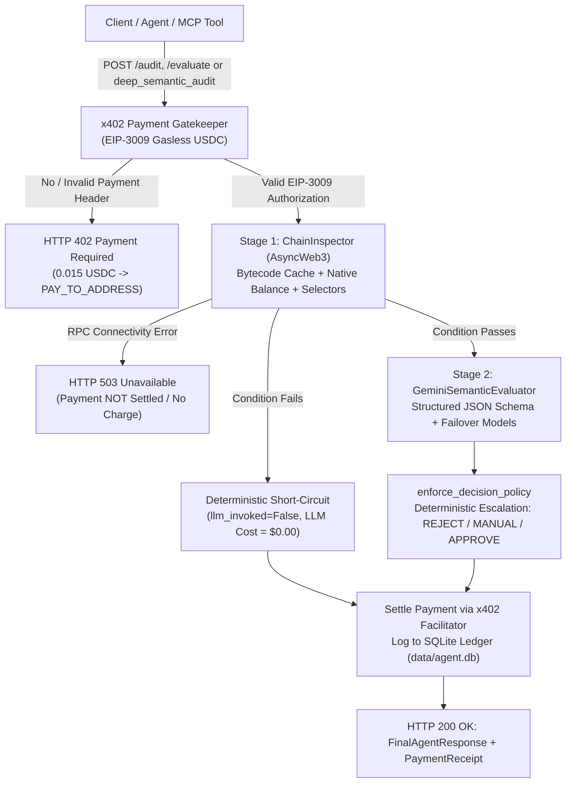

# Web3 Condition-Action Trigger Agent
### Autonomous Web3 Security & Governance Auditor with Two-Stage Hybrid LLM Pipeline & x402 Bazaar Micropayments

[](https://www.python.org/downloads/)
[](https://pypi.org/project/web3-systemic-agent/)
[](https://base.org)
[-2775C9.svg)](https://x402.org)
[](https://modelcontextprotocol.io)
[](https://glama.ai/mcp/servers/@RafaCoelho33/web3-systemic-agent)
[](https://mcptry.com/servers/io.github.RafaCoelho33/web3-systemic-agent)
[](https://m8ven.ai/mcp/rafacoelho33/web3-systemic-agent?s=readme)
[](https://ai.google.dev/)
[](https://opensource.org/licenses/Apache-2.0)

An autonomous Web3 agent engineered for real-time smart contract monitoring, DEX honeypot detection, and DAO governance security. Features a **two-stage hybrid architecture** that combines zero-cost deterministic on-chain gatekeeping with structured Gemini LLM evaluations, monetized Agent-to-Agent (A2A) via **x402 gasless USDC micropayments** on Base.

Operates natively as both a high-throughput **FastAPI REST Service** and a **Model Context Protocol (MCP) Server** compatible with Claude Desktop, Cursor, Smithery, Glama, and Coinbase AgentKit.

---

## 🌐 Live Production Service

The service is continuously deployed and operational in production on [Render](https://render.com):

* **Base URL:** [`https://web3-systemic-agent.onrender.com`](https://web3-systemic-agent.onrender.com)
* **MCP Discovery / Streamable-HTTP:** [`https://web3-systemic-agent.onrender.com/mcp`](https://web3-systemic-agent.onrender.com/mcp)
* **A2A Agent Card:** [`https://web3-systemic-agent.onrender.com/.well-known/agent-card.json`](https://web3-systemic-agent.onrender.com/.well-known/agent-card.json)
* **x402 Discovery Metadata:** [`https://web3-systemic-agent.onrender.com/.well-known/x402`](https://web3-systemic-agent.onrender.com/.well-known/x402)
* **x402 Pricing Tiers:** `0.005 USDC` (`/token/check`) · `0.01 USDC` (`/preflight`) · `0.015 USDC` (`/audit`, `/evaluate`) · `0.25 USDC` (`/audit/deep`) — EIP-3009 Gasless
* **Default Production Network:** Base Mainnet (`eip155:8453`) & Base Sepolia (`eip155:84532`)
* **Agent Recipient Wallet (`PAY_TO_ADDRESS`):** [`0x2b7F1fd931f7f28f89e0f688Dd5Bb7a620c24b63`](https://basescan.org/address/0x2b7F1fd931f7f28f89e0f688Dd5Bb7a620c24b63)

### Canonical API Endpoints

| Method | Route | Description | x402 Micropayment |
| :--- | :--- | :--- | :--- |
| `GET` | `/` | Service discovery, payment parameters, and endpoint directory | Free |
| `GET` | `/health` | Uptime probe, multi-chain RPC connectivity, LLM status | Free |
| `GET` | `/.well-known/x402` | x402 v2 service specification and Bazaar discovery resources | Free |
| `GET` | `/.well-known/agent-card.json` | Agent-to-Agent (A2A) discovery card and capability manifest | Free |
| `GET` | `/.well-known/owners.json` | Verified project ownership metadata (GitHub + payout wallet) | Free |
| `GET` | `/feed/recent` | Recent autonomous security audits and discovery feed | Free |
| `GET` | `/report/{chain_id}/{address}` | Public security audit report lookup by chain ID and contract address | Free |
| `GET` | `/mcp` | MCP server discovery, transport metadata, tools manifest | Free |
| `POST` | `/mcp` | MCP JSON-RPC 2.0 execution endpoint (streamable-http) | Free / 402 for Deep Audit |
| `POST` | `/rules/validate` | Static deterministic rule pre-validation and syntax check | Free |
| `GET` / `POST` | `/token/check` | Fast static token honeypot, selector & proxy screening (`TokenCheckResponse`) | **0.005 USDC** |
| `GET` / `POST` | `/preflight` | Pre-sign firewall: Permit2/approval decode, EIP-712, IPI & `eth_call` simulation | **0.01 USDC** |
| `GET` / `POST` | `/audit` | Simplified one-shot Smart Contract Audit (`QuickAuditRequest`) | **0.015 USDC** |
| `GET` / `POST` | `/evaluate` | Two-stage hybrid evaluation (`ConditionRulePayload` + Gemini LLM) | **0.015 USDC** |
| `GET` / `POST` | `/audit/deep` | Deep Tier Pro Audit: EIP-1967 proxy resolution + Sourcify/Etherscan source + LLM | **0.25 USDC** |
| `POST` | `/rules/evaluate-batch` | Synchronous batch evaluation for up to 50 rules | Free / Sub-rules gated |
| `POST` | `/rules/enqueue` | Asynchronous evaluation queue returning unique `job_id` | Free |
| `GET` | `/jobs/{job_id}` | Asynchronous job status inspection and results retrieval | Free |

---

## 🔌 Model Context Protocol (MCP) Server

The agent provides a first-class **Model Context Protocol (MCP)** server (`src/mcp_server.py`) implementing protocol specification `2024-11-05`. It exposes **6 tools** (5 free Stage 1 on-chain analysis tools + 1 paid Stage 2 deep semantic audit tool), **4 MCP Resources**, and **3 MCP Prompts**:

```
                                  ┌───────────────────────────────────────────────┐
                                  │         MCP Server Registry (v1.0.2)          │
                                  │   6 Tools  ·  4 Resources  ·  3 Prompts       │
                                  └───────────────────────────────────────────────┘
                                                          │
                    ┌─────────────────────────────────────┴─────────────────────────────────────┐
                    ▼                                                                           ▼
      ┌───────────────────────────┐                                               ┌───────────────────────────┐
      │   STAGE 1: 5 FREE TOOLS   │                                               │    STAGE 2: PAID AUDIT    │
      │   (Deterministic / $0.00) │                                               │ ($0.015 / $0.25 via x402) │
      └───────────────────────────┘                                               └───────────────────────────┘
                    │                                                                           │
       ├── scan_contract_selectors  ───> Discovers EVM selectors & high-risk backdoors          │
       ├── check_token_honeypot     ───> Static bytecode analysis for tax & blacklist traps     │
       ├── scan_dao_proposals       ───> Ingests Snapshot DAO proposals & calldata payloads     │
       ├── preflight_tx_firewall    ───> Permit2/EIP-712/IPI firewall & eth_call simulation     │
       └── inspect_proxy_and_source ───> EIP-1967/Beacon proxy slots & Sourcify/Etherscan       │
                                                                                                │
                               └─── (Upsell Recommendation Triggered) ──────────────────────────┘
                                                                ▼
                                                      deep_semantic_audit
                                         (Two-Stage Gatekeeping + Gemini LLM Reasoning)
```

### 1. Free Stage 1 Tools (5 Tools — `$0.00`)

#### `scan_contract_selectors`
* **Purpose:** Free deterministic bytecode inspection on Base or any EVM network. Discovers 4-byte function selectors and flags high-privilege administrative backdoors (`transferOwnership`, `upgradeTo`, `mint`, `selfdestruct`).
* **Parameters:**
  * `target_address` *(string, required)*: Hex EVM smart contract address.
  * `chain_id` *(integer, default 8453)*: EVM Chain ID (8453 for Base Mainnet, 84532 for Base Sepolia, 42161 for Arbitrum One).
  * `bytecode_override` *(string, optional)*: Raw contract runtime bytecode hex string for offline analysis.
* **Returns:** Contract status, bytecode size, extracted selectors, flagged high-risk capabilities, risk level (`HIGH`, `LOW`, `EOA`), and upsell recommendation.

#### `check_token_honeypot`
* **Purpose:** Free static bytecode analysis for DEX honeypots, rugpull traps, and malicious token contracts:
  * Blacklist manipulation (`isBlacklisted`, `setBlacklist`, `addToBlacklist`)
  * Arbitrary transfer taxes & 100% sell fee traps (`setTax`, `setFee`, `setSellFee`)
  * Trading freeze and pause backdoors (`pause`, `setTrading`, `enableTrading`)
  * EVM `SELFDESTRUCT` (opcode `0xff`) drainage traps
* **Parameters:**
  * `token_address` *(string, required)*: Hex EVM address of token contract.
  * `chain_id` *(integer, default 8453)*: EVM Chain ID.
  * `bytecode_override` *(string, optional)*: Raw token runtime bytecode for offline analysis.
* **Returns:** `is_honeypot_suspect` boolean, numeric `risk_score` (0.0 to 10.0), active threat categories, detailed risk flags, and audit upsell guidance.

#### `scan_dao_proposals`
* **Purpose:** Free scanner for recent Snapshot DAO governance proposals (Arbitrum, Aave, ENS, etc.). Extracts proposed execution targets, native Wei value transfers, and 4-byte calldata to detect governance hijack attempts.
* **Parameters:**
  * `space_id` *(string, default "arbitrumfoundation.eth")*: Snapshot DAO space ENS domain.
  * `limit` *(integer, default 3)*: Maximum proposals to fetch.
  * `use_curated_offline` *(boolean, default false)*: If true, returns verified realistic curated proposals without outbound network calls.
* **Returns:** Proposal IDs, natural language titles, execution targets, calldata payloads, and audit recommendations.

#### `preflight_tx_firewall`
* **Purpose:** Free pre-sign transaction security firewall evaluating EVM transaction risks, calldata decoding, unlimited ERC-20/Permit2/`setApprovalForAll` approvals, EIP-712 typed-data phishing, Indirect Prompt Injection (IPI) in untrusted metadata, and simulated state changes via `eth_call`.
* **Parameters:**
  * `to_address` *(string, optional)* / `target_address` *(string, optional)*: Target contract or recipient EVM address.
  * `from_address` *(string, optional)*: Optional sender EVM address.
  * `calldata` *(string, default "0x")*: Hex transaction calldata.
  * `value_wei` *(integer, default 0)*: Transaction value in Wei.
  * `chain_id` *(integer, default 8453)*: EVM Chain ID.
  * `eip712_typed_data` *(object, optional)*: EIP-712 typed data payload to inspect before signing.
  * `untrusted_text` *(string, optional)*: Untrusted text or proposal description to scan for Indirect Prompt Injection.
  * `run_simulation` *(boolean, default true)*: Whether to execute `eth_call` simulation on-chain.
* **Returns:** `verdict` (`ALLOW`, `BLOCK`, `MANUAL_REVIEW`), `risk_score` (0.0 to 10.0), `flagged_issues`, `approval_risks`, `eip712_findings`, `prompt_injection_detected`, `reasons`, and `summary`.

#### `inspect_proxy_and_source`
* **Purpose:** Free EIP-1967 / EIP-1822 / Beacon proxy storage slot inspector and verified Solidity source resolver. Probes on-chain `implementation`, `admin`, `beacon`, `owner()`, and `paused()` states via `AsyncWeb3` and queries Sourcify / Etherscan v2 without invoking any LLM.
* **Parameters:**
  * `target_address` *(string, required)*: Hex EVM address of smart contract or proxy to inspect.
  * `chain_id` *(integer, default 8453)*: EVM Chain ID (8453, 84532, 42161).
  * `fetch_verified_source` *(boolean, default true)*: Whether to query Sourcify/Etherscan v2 for verified source metadata.
  * `offline_mode` *(boolean, default false)*: If true, returns a deterministic clean offline structure without making RPC or HTTP calls.
* **Returns:** `is_proxy`, `implementation_address`, `admin_address`, `beacon_address`, `owner_address`, `is_paused`, `source_verified`, `source_provider`, `contract_names`, `security_warnings`, and `recommendation`.

### 2. Paid Stage 2 Tool (1 Tool — x402 USDC)

#### `deep_semantic_audit`
* **Purpose:** Two-stage autonomous security and governance audit. Executes deterministic on-chain gatekeeping followed by structured Google Gemini LLM reasoning crossing natural language claims with actual bytecode, proxy state, verified Solidity source, and calldata reality.
* **Parameters:**
  * `target_address` *(string, required)*: Hex EVM smart contract address.
  * `proposal_description` *(string, required)*: Natural language claim or governance proposal explanation.
  * `policy_prompt` *(string, optional)*: Security policy or criteria to audit against.
  * `calldata` *(string, default "0x")*: Transaction hex calldata being executed.
  * `chain_id` *(integer, default 8453)*: EVM Chain ID.
  * `risk_threshold` *(number, default 7.0)*: Threshold (0.0 to 10.0) above which intervention is warranted.
  * `resolve_proxy` *(boolean, default false)*: If true, resolves EIP-1967/1822 proxy implementation state.
  * `fetch_verified_source` *(boolean, default false)*: If true, retrieves verified Solidity source code from Sourcify/Etherscan.
  * `x402_payment_header` *(string, optional)*: Base64-encoded EIP-3009 transfer authorization satisfying `$0.015 USDC` (standard) or `$0.25 USDC` (when `resolve_proxy=True` or `fetch_verified_source=True`).
* **Pricing & Micropayment Flow:**
  * Standard tier: **`$0.015 USDC`** · Deep Proxy + Verified Source tier: **`$0.25 USDC`** (EIP-3009 on Base).
  * If invoked without payment credentials, returns a structured HTTP 402 payment challenge with the exact recipient address, amount, and instructions without charging.
  * If `x402_payment_header` is supplied (or `X402_BUYER_PRIVATE_KEY` is configured in the environment), the audit executes immediately and returns a deterministic policy result (`APPROVE`, `MANUAL_REVIEW`, or `REJECT`) with risk scores and flagged issues.

### 3. MCP Resources (4 Resources)

| Resource URI | MIME Type | Description |
| :--- | :--- | :--- |
| `web3://x402/pricing` | `application/json` | Live x402 USDC pricing tiers (`/token/check`, `/preflight`, `/audit`, `/audit/deep`), payout address, and supported networks |
| `web3://security/selectors-catalog` | `application/json` | Static catalog of known 4-byte EVM administrative selectors, high-risk keywords, and DEX honeypot/rugpull signatures |
| `web3://feed/dao-curated-proposals` | `application/json` | Deterministic curated dataset of Snapshot DAO governance proposals with extracted on-chain target contracts and calldata |
| `web3://feed/recent-audits` | `application/json` | Most recent autonomous contract and governance security evaluations recorded in `AgentStorage` |

### 4. MCP Prompts (3 Prompts)

| Prompt Name | Arguments | Workflow |
| :--- | :--- | :--- |
| `audit-token-before-swap` | `token_address` *(required)*, `chain_id` *(optional)* | Guided pre-swap ERC-20 check: `check_token_honeypot` -> `scan_contract_selectors` -> `inspect_proxy_and_source` -> conditional `deep_semantic_audit` |
| `pre-sign-transaction-firewall` | `to_address` *(required)*, `calldata` *(optional)* | Pre-sign security check: `preflight_tx_firewall` + `inspect_proxy_and_source` before signing |
| `audit-dao-governance-space` | `space_id` *(optional)* | Snapshot DAO governance workflow: `scan_dao_proposals` -> `preflight_tx_firewall` / `inspect_proxy_and_source` -> conditional `deep_semantic_audit` |

---

## 🛠️ MCP Client Configuration & Installation

### One-Command Execution (`uvx` / `pip`)

Run the MCP server directly without manual cloning:

```bash
# Run directly with uvx (Zero manual setup)
uvx --from git+https://github.com/RafaCoelho33/web3-systemic-agent web3-systemic-agent --dry-run
```

### Claude Desktop

Add the server to your `claude_desktop_config.json`:

* **macOS:** `~/Library/Application Support/Claude/claude_desktop_config.json`
* **Windows:** `%APPDATA%\Claude\claude_desktop_config.json`

```json
{
  "mcpServers": {
    "web3-systemic-agent": {
      "command": "python",
      "args": ["-m", "src.mcp_server"],
      "cwd": "/path/to/web3-systemic-agent",
      "env": {
        "WEB3_AGENT_URL": "https://web3-systemic-agent.onrender.com",
        "X402_BUYER_PRIVATE_KEY": ""
      }
    }
  }
}
```

### Cursor IDE

Create or edit `.cursor/mcp.json` in your project root or user config:

```json
{
  "mcpServers": {
    "web3-systemic-agent": {
      "command": "python",
      "args": ["-m", "src.mcp_server"],
      "env": {
        "WEB3_AGENT_URL": "https://web3-systemic-agent.onrender.com"
      }
    }
  }
}
```

### Smithery (`smithery.yaml`)

Install directly via [Smithery.ai](https://smithery.ai):

```bash
smithery run web3-systemic-agent
```

Or reference the local manifest:
```yaml
startCommand:
  type: stdio
  configSchema:
    type: object
    properties:
      web3AgentUrl:
        type: string
        default: "https://web3-systemic-agent.onrender.com"
      x402BuyerPrivateKey:
        type: string
  commandFunction:
    python: "python -m src.mcp_server"
```

### Glama (`glama.json`)

Verified for the [Glama MCP Directory](https://glama.ai/mcp):

```json
{
  "$schema": "https://glama.ai/mcp/schemas/server.json",
  "name": "web3-systemic-agent",
  "maintainers": ["RafaCoelho33"],
  "homepage": "https://web3-systemic-agent.onrender.com",
  "repository": "https://github.com/RafaCoelho33/web3-systemic-agent",
  "capabilities": {
    "tools": true,
    "resources": true,
    "prompts": true
  }
}
```

### Coinbase AgentKit / Streamable-HTTP

Connect via HTTP streaming to the remote MCP endpoint without local installation:

```python
import httpx

# Ingest tools manifest via Streamable-HTTP
async with httpx.AsyncClient() as client:
    resp = await client.get("https://web3-systemic-agent.onrender.com/mcp")
    tools = resp.json()["tools"]
```

---

## 🛰️ Autonomous Discovery, On-Chain Identity & IDE Integrations (v1.0.2)

### Active Multi-Channel Contract Hunter (`scripts/active_contract_hunter.py`)

Autonomous discovery engine (`src/discovery_hunter.py` -> `ActiveContractHunter`) that proactively hunts newly deployed contracts, DEX tokens, and DAO governance payloads across **5 zero-API-key, zero-gas channels** with FIFO deduplication (`2048` cache entries) and deterministic Stage 1->2 triage:

1. **`base_blocks`**: Newly deployed smart contracts on Base Mainnet (`scan_recent_blocks`).
2. **`dex_pools`**: Newly created Aerodrome & Uniswap v3 `PoolCreated` pools (`scan_pool_events`).
3. **`geckoterminal_base`**: GeckoTerminal public New Pools API (`/api/v2/networks/base/new_pools`).
4. **`dexscreener_base`**: DexScreener public Latest Token Profiles API filtered to Base (`chainId == "base"`).
5. **`snapshot_daos`**: Active Snapshot DAO governance proposals with extracted on-chain execution targets.

```bash
# Dry-run offline simulation across all 5 discovery channels
python scripts/active_contract_hunter.py --dry-run --once

# Continuous live multi-channel daemon with webhook alerting
python scripts/active_contract_hunter.py --continuous --poll-interval 60 --webhook-url https://discord.com/api/webhooks/...
```

### ERC-8004 On-Chain Identity (`scripts/register_erc8004_agent.py`)

Generates, validates, and ABI-encodes the **ERC-8004 ("Trustless Agents")** registration manifest (`https://eips.ethereum.org/EIPS/eip-8004#registration-v1`) for indexing on Base Mainnet (`8004scan.io` / `8004agents.ai`), including `data:application/json;base64,...` `agentURI` encoding and `register(string)` calldata (`0xf2c298be`):

```bash
python scripts/register_erc8004_agent.py --dry-run
```

### Cursor Rules (`.cursorrules`) & OpenClaw / ClawHub Skill (`integrations/openclaw/SKILL.md`)

* **`.cursorrules`**: Drop-in Cursor IDE rule file instructing AI coding assistants to invoke free Stage 1 MCP tools (`preflight_tx_firewall`, `check_token_honeypot`, `scan_contract_selectors`, `inspect_proxy_and_source`, `scan_dao_proposals`) before recommending contract interactions or transaction signatures, escalating to paid `deep_semantic_audit` only on flagged risk.
* **`integrations/openclaw/SKILL.md`**: Ready-to-publish OpenClaw / ClawHub skill manifest wiring both the Streamable-HTTP/stdio MCP tools and the x402-gated HTTP REST endpoints (`/token/check`, `/preflight`, `/audit`, `/audit/deep`).

---

## 🏗️ Two-Stage Architecture & x402 Micropayments



### Proven Live On-Chain Settlements (Base Mainnet)

Real **EIP-3009 (`transferWithAuthorization`)** USDC settlements executed on **Base Mainnet (Chain ID: `8453`)** via the Coinbase CDP x402 Facilitator and indexed in the **x402 Bazaar**:

| Endpoint | Settled Amount | Transaction Hash | Status |
| :--- | :--- | :--- | :--- |
| `POST /audit` | `0.015 USDC` | [`0x2ee54ab1bf34...`](https://basescan.org/tx/0x2ee54ab1bf344998c4e5f4ebb9b30fa0a3d96accb1be813beefd0863e3e5ccc0) | `Success` (Gasless EIP-3009) |
| `POST /evaluate` | `0.015 USDC` | [`0xecc0a97196f7...`](https://basescan.org/tx/0xecc0a97196f7f4a27379e266e10bd652bb4672c278f58376d0bc6cd49f5eb0ff) | `Success` (Gasless EIP-3009) |
| `POST /audit` | `0.05 USDC` | [`0xbcc7ebd3d956...`](https://basescan.org/tx/0xbcc7ebd3d9561f01ae1e190a35509a7a70163c42115cba5588db35c34e0b0f10) | `Success` (Gasless EIP-3009) |

### Proven Live On-Chain Settlements (Base Sepolia)

The x402 A2A settlement cycle using **EIP-3009 (`transferWithAuthorization`)** has been verified and settled on **Base Sepolia (Chain ID: `84532`)** with zero gas ETH consumed by the buyer or agent:

| Metric | Transaction 1 (Direct Settlement) | Transaction 2 (Live Mempool Capture) | Transaction 3 (Production Render) |
| :--- | :--- | :--- | :--- |
| **Transaction Hash** | [`0xa02872819cef...`](https://sepolia.basescan.org/tx/0xa02872819cef168637efe50d917441fd196cd03b4baafc7b9ff3dc624f18fc0d) | [`0x6aa7c671469d...`](https://sepolia.basescan.org/tx/0x6aa7c671469d2d9a2e0a8eb3682d285394795a2da369573214f7eaad6759b647) | [`0x63ea962e6f0d...`](https://sepolia.basescan.org/tx/0x63ea962e6f0d83b73116cfc4f084b6f9495c47fa020f8db703508b5fbd06e6b5) |
| **Settlement Method** | Direct EIP-3009 call | Live mempool/block scan | `POST https://web3-systemic-agent.onrender.com/evaluate` |
| **On-Chain Status** | `Success` (Block `54583500`) | `Success` (Block `54644484`) | `Success` |
| **Agent Wallet (`PAY_TO_ADDRESS`)** | [`0x2b7F1fd931...`](https://sepolia.basescan.org/address/0x2b7F1fd931f7f28f89e0f688Dd5Bb7a620c24b63#tokentxns) | [`0x2b7F1fd931...`](https://sepolia.basescan.org/address/0x2b7F1fd931f7f28f89e0f688Dd5Bb7a620c24b63#tokentxns) | [`0x2b7F1fd931...`](https://sepolia.basescan.org/address/0x2b7F1fd931f7f28f89e0f688Dd5Bb7a620c24b63#tokentxns) |
| **Buyer Wallet (A2A Agent)** | [`0x4EbC7529d8...`](https://sepolia.basescan.org/address/0x4EbC7529d8c948ed1245A8106F2834969dbCec2b#tokentxns) | [`0x4EbC7529d8...`](https://sepolia.basescan.org/address/0x4EbC7529d8c948ed1245A8106F2834969dbCec2b#tokentxns) | [`0x4EbC7529d8...`](https://sepolia.basescan.org/address/0x4EbC7529d8c948ed1245A8106F2834969dbCec2b#tokentxns) |
| **x402 Facilitator (Gas Sponsor)** | [`0xd407e409E3...`](https://sepolia.basescan.org/address/0xd407e409E34E0b9afb99EcCeb609bDbcD5e7f1bf) (`https://x402.org/facilitator`) | [`0xd407e409E3...`](https://sepolia.basescan.org/address/0xd407e409E34E0b9afb99EcCeb609bDbcD5e7f1bf) (`https://x402.org/facilitator`) | [`0xd407e409E3...`](https://sepolia.basescan.org/address/0xd407e409E34E0b9afb99EcCeb609bDbcD5e7f1bf) (`https://x402.org/facilitator`) |
| **USDC Token Contract** | [`0x036CbD5384...`](https://sepolia.basescan.org/token/0x036CbD53842c5426634e7929541eC2318f3dCF7e) | [`0x036CbD5384...`](https://sepolia.basescan.org/token/0x036CbD53842c5426634e7929541eC2318f3dCF7e) | [`0x036CbD5384...`](https://sepolia.basescan.org/token/0x036CbD53842c5426634e7929541eC2318f3dCF7e) |
| **Settled Amount** | `0.01 USDC` | `0.01 USDC` | `0.05 USDC` |
| **Gas Cost (Buyer / Server)** | `0.00 ETH` (Gasless EIP-3009) | `0.00 ETH` (Gasless EIP-3009) | `0.00 ETH` (Gasless EIP-3009) |

---

## 📁 Repository Structure

```
├── src/
│   ├── api.py                      # FastAPI service, x402 middleware, REST, A2A & MCP endpoints
│   ├── mcp_server.py               # MCP server (6 tools, 4 resources, 3 prompts — stdio & HTTP)
│   ├── engine.py                   # ConditionAgentEngine two-stage orchestrator
│   ├── chain_inspector.py          # Stage 1 deterministic on-chain gatekeeper with FIFO cache
│   ├── preflight_firewall.py       # Pre-sign tx firewall: Permit2, EIP-712, IPI & eth_call sim
│   ├── source_resolver.py          # EIP-1967/Beacon proxy resolver & Sourcify/Etherscan lookup
│   ├── discovery_hunter.py         # ActiveContractHunter 5-channel autonomous discovery engine
│   ├── semantic_evaluator.py       # Stage 2 Gemini/OpenAI LLM evaluator with cooldown failovers
│   ├── schemas.py                  # Pydantic v2 strict schemas and contracts
│   ├── x402_payment.py             # x402 protocol, EIP-3009 signatures, replay defense
│   ├── governance_connector.py     # Snapshot GraphQL connector & Discord/Slack dispatcher
│   ├── storage.py                  # Asynchronous SQLite ledger with automatic secret redaction
│   ├── task_worker.py              # In-memory background task worker pool
│   └── report.py                   # Telemetry CLI reporting token costs, revenue, net profit
├── scripts/
│   ├── active_contract_hunter.py   # 5-channel Active Contract Hunter CLI (--dry-run / --continuous)
│   ├── register_erc8004_agent.py   # ERC-8004 Trustless Agent manifest & calldata generator
│   ├── block_contract_scanner.py   # Autonomous Base Mainnet block deployment scanner
│   ├── dex_pool_monitor.py         # Uniswap v3 & Aerodrome pool event monitor & honeypot engine
│   ├── governance_listener.py      # Snapshot DAO sentinel bot
│   ├── client_agent_x402.py        # Standalone A2A client with real on-chain settlement
│   └── setup_buyer_wallet.py       # Wallet generation and USDC balance inspection utility
├── integrations/
│   └── openclaw/SKILL.md           # OpenClaw / ClawHub agent skill definition
├── tests/                          # Automated unit, security, and integration test suite
├── .cursorrules                    # Cursor IDE security policy enforcing Stage 1 MCP checks
├── smithery.yaml                   # Smithery MCP registry manifest
├── glama.json                      # Glama MCP directory configuration
├── Dockerfile                      # Production Docker container definition
├── docker-compose.yml              # Local containerized orchestration
└── .env.example                    # Environment configuration template
```

---

## ⚡ Quickstart & Setup

### 1. Installation

```bash
git clone https://github.com/RafaCoelho33/web3-systemic-agent.git
cd web3-systemic-agent

# Install core and development dependencies
pip install -r requirements-dev.txt
```

### 2. Configuration (`.env`)

Copy the template and provide your API keys:

```bash
cp .env.example .env
```

Key environment variables:
```env
# Server
PORT=8000
PUBLIC_EVALUATE_ONLY=true

# Google Gemini API
GEMINI_API_KEY=your_gemini_api_key_here
GEMINI_MODEL=gemini-3.5-flash-lite
GEMINI_FAILOVER_MODELS=gemini-3.5-flash-lite,gemini-3.1-flash-lite,gemini-2.5-flash-lite,gemini-2.0-flash

# x402 Micropayment Protocol
PAY_TO_ADDRESS=0x2b7F1fd931f7f28f89e0f688Dd5Bb7a620c24b63
X402_ENABLED=true
X402_NETWORK=eip155:8453
X402_PRICE_EVALUATE=0.015
X402_USE_LIVE_FACILITATOR=true
```

### 3. Verify MCP Server Offline

```bash
python src/mcp_server.py --dry-run
```

Expected output:
```
=== Web3 Systemic Agent MCP Server Self-Test ===
[1/9] Registered 6 MCP tools: scan_contract_selectors, check_token_honeypot, scan_dao_proposals, deep_semantic_audit, preflight_tx_firewall, inspect_proxy_and_source
[2/9] Tool 'scan_contract_selectors' OK: risk_level=LOW, selectors=1, cost=$0.00
[3/9] Tool 'check_token_honeypot' OK: is_honeypot=True, score=7.5, cost=$0.00
[4/9] Tool 'scan_dao_proposals' OK: count=1, cost=$0.00
[5/9] Tool 'preflight_tx_firewall' OK: verdict=MANUAL_REVIEW, risk_score=7.5, cost=$0.00
[6/9] Tool 'inspect_proxy_and_source' OK: is_proxy=False, source_verified=False, cost=$0.00
[7/9] Tool 'deep_semantic_audit' OK: status=payment_required, status_code=402, price_usdc=0.05
[8/9] MCP resources/list & resources/read OK: 4 resources verified
[9/9] MCP prompts/list & prompts/get OK: 3 prompts verified
=== All MCP self-tests PASSED successfully ===
```

### 4. Run the Full Test Suite

```bash
pytest
```

---

## 📜 License

This project is licensed under the **[Apache License 2.0](LICENSE)** (`SPDX-License-Identifier: Apache-2.0`).

* **Copyright:** Copyright (c) 2026 [RafaCoelho33](https://github.com/RafaCoelho33). All rights reserved under Apache-2.0 terms (including trademark protection under Section 6 and mandatory attribution under Section 4).

<!-- mcp-name: io.github.RafaCoelho33/web3-systemic-agent -->
