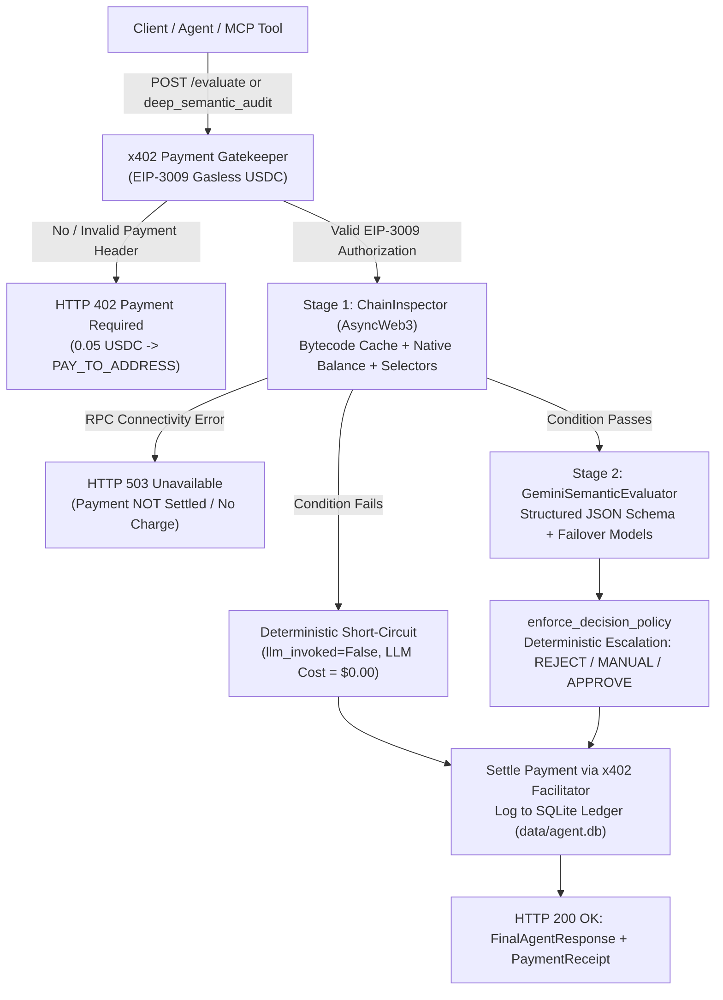

# Web3 Condition-Action Trigger Agent
### Autonomous Web3 Security & Governance Auditor with Two-Stage Hybrid LLM Pipeline & x402 Bazaar Micropayments

[](https://www.python.org/downloads/)
[](https://base.org)
[-2775C9.svg)](https://x402.org)
[](https://modelcontextprotocol.io)
[](https://m8ven.ai/mcp/rafacoelho33-web3-systemic-agent-jkr9w6?s=readme)
[](https://ai.google.dev/)
[](LICENSE)

An autonomous Web3 agent engineered for real-time smart contract monitoring, DEX honeypot detection, and DAO governance security. Features a **two-stage hybrid architecture** that combines zero-cost deterministic on-chain gatekeeping with structured Gemini LLM evaluations, monetized Agent-to-Agent (A2A) via **x402 gasless USDC micropayments** on Base.

Operates natively as both a high-throughput **FastAPI REST Service** and a **Model Context Protocol (MCP) Server** compatible with Claude Desktop, Cursor, Smithery, Glama, and Coinbase AgentKit.

---

## 🌐 Live Production Service

The service is continuously deployed and operational in production on [Render](https://render.com):

* **Base URL:** [`https://web3-systemic-agent.onrender.com`](https://web3-systemic-agent.onrender.com)
* **MCP Discovery / Streamable-HTTP:** [`https://web3-systemic-agent.onrender.com/mcp`](https://web3-systemic-agent.onrender.com/mcp)
* **Deep Semantic Audit Price:** `0.05 USDC` (EIP-3009 Gasless)
* **Default Production Network:** Base Mainnet (`eip155:8453`) & Base Sepolia (`eip155:84532`)
* **Agent Recipient Wallet (`PAY_TO_ADDRESS`):** [`0x2b7F1fd931f7f28f89e0f688Dd5Bb7a620c24b63`](https://basescan.org/address/0x2b7F1fd931f7f28f89e0f688Dd5Bb7a620c24b63)

### Canonical API Endpoints

| Method | Route | Description | x402 Micropayment |
| :--- | :--- | :--- | :--- |
| `GET` | `/` | Service discovery, payment parameters, and endpoint directory | Free |
| `GET` | `/health` | Uptime probe, multi-chain RPC connectivity, LLM status | Free |
| `GET` | `/mcp` | MCP server discovery, transport metadata, tools manifest | Free |
| `POST` | `/mcp` | MCP JSON-RPC 2.0 execution endpoint (streamable-http) | Free / 402 for Deep Audit |
| `POST` | `/rules/validate` | Static deterministic rule pre-validation and syntax check | Free |
| `POST` | `/evaluate` | Two-stage hybrid evaluation (Deterministic + Gemini LLM) | **0.05 USDC** |
| `POST` | `/rules/evaluate-batch` | Synchronous batch evaluation for up to 50 rules | Free / Sub-rules gated |
| `POST` | `/rules/enqueue` | Asynchronous evaluation queue returning unique `job_id` | Free |
| `GET` | `/jobs/{job_id}` | Asynchronous job status inspection and results retrieval | Free |

---

## 🔌 Model Context Protocol (MCP) Server

The agent provides a first-class **Model Context Protocol (MCP)** server (`src/mcp_server.py`) implementing protocol specification `2024-11-05`. It serves 3 free Stage 1 on-chain analysis tools to discover and qualify threats, and 1 paid Stage 2 tool for deep semantic auditing:

```
                                  ┌───────────────────────────────────────────────┐
                                  │           MCP Server Tools Registry           │
                                  └───────────────────────────────────────────────┘
                                                          │
                    ┌─────────────────────────────────────┴─────────────────────────────────────┐
                    ▼                                                                           ▼
      ┌───────────────────────────┐                                               ┌───────────────────────────┐
      │     STAGE 1: FREE TOOLS   │                                               │    STAGE 2: PAID AUDIT    │
      │   (Deterministic / $0.00) │                                               │     ($0.05 USDC via x402) │
      └───────────────────────────┘                                               └───────────────────────────┘
                    │                                                                           │
       ├── scan_contract_selectors ───> Discovers EVM selectors & high-risk backdoors           │
       ├── check_token_honeypot    ───> Static bytecode analysis for tax & blacklist traps      │
       └── scan_dao_proposals      ───> Ingests Snapshot DAO proposals & calldata payloads     │
                                                                                                │
                               └─── (Upsell Recommendation Triggered) ──────────────────────────┘
                                                                ▼
                                                      deep_semantic_audit
                                        (Two-Stage Gatekeeping + Gemini LLM Reasoning)
```

### 1. Free Stage 1 Tools

#### `scan_contract_selectors`
* **Purpose:** Free deterministic bytecode inspection on Base or any EVM network. Discovers 4-byte function selectors and flags high-privilege administrative backdoors (`transferOwnership`, `upgradeTo`, `mint`, `selfdestruct`).
* **Parameters:**
  * `target_address` *(string, required)*: Hex EVM smart contract address.
  * `chain_id` *(integer, default 8453)*: EVM Chain ID (8453 for Base Mainnet, 84532 for Base Sepolia).
  * `bytecode_override` *(string, optional)*: Raw contract runtime bytecode hex string for offline analysis.
* **Returns:** Contract status, bytecode size, extracted selectors, flagged high-risk capabilities, risk level (`HIGH`, `LOW`, `EOA`), and upsell recommendation.

#### `check_token_honeypot`
* **Purpose:** Free static bytecode analysis for DEX honeypots, rugpull traps, and malicious token contracts:
  * Blacklist manipulation (`isBlacklisted`, `setBlacklist`, `addToBlacklist`)
  * Arbitrary transfer taxes & 100% sell fee traps (`setTax`, `setFee`, `setSellFee`)
  * Trading freeze and pause backdoors (`pause`, `setTrading`, `enableTrading`)
  * EVM `SELFDESTRUCT` (opcode `0xff`) drainage traps
* **Parameters:**
  * `token_address` *(string, required)*: Hex EVM address of token contract.
  * `chain_id` *(integer, default 8453)*: EVM Chain ID.
  * `bytecode_override` *(string, optional)*: Raw token runtime bytecode for offline analysis.
* **Returns:** `is_honeypot_suspect` boolean, numeric `risk_score` (0.0 to 10.0), active threat categories, detailed risk flags, and audit upsell guidance.

#### `scan_dao_proposals`
* **Purpose:** Free scanner for recent Snapshot DAO governance proposals (Arbitrum, Aave, ENS, etc.). Extracts proposed execution targets, native Wei value transfers, and 4-byte calldata to detect governance hijack attempts.
* **Parameters:**
  * `space_id` *(string, default "arbitrumfoundation.eth")*: Snapshot DAO space ENS domain.
  * `limit` *(integer, default 3)*: Maximum proposals to fetch.
  * `use_curated_offline` *(boolean, default false)*: If true, returns verified realistic curated proposals without outbound network calls.
* **Returns:** Proposal IDs, natural language titles, execution targets, calldata payloads, and audit recommendations.

### 2. Paid Stage 2 Tool

#### `deep_semantic_audit`
* **Purpose:** Two-stage autonomous security and governance audit. Executes deterministic on-chain gatekeeping followed by structured Google Gemini LLM reasoning crossing natural language claims with actual bytecode and calldata reality.
* **Parameters:**
  * `target_address` *(string, required)*: Hex EVM smart contract address.
  * `proposal_description` *(string, required)*: Natural language claim or governance proposal explanation.
  * `policy_prompt` *(string, optional)*: Security policy or criteria to audit against.
  * `calldata` *(string, default "0x")*: Transaction hex calldata being executed.
  * `chain_id` *(integer, default 8453)*: EVM Chain ID.
  * `risk_threshold` *(number, default 7.0)*: Threshold (0.0 to 10.0) above which intervention is warranted.
  * `x402_payment_header` *(string, optional)*: Base64-encoded EIP-3009 transfer authorization satisfying $0.05 USDC payment.
* **Pricing & Micropayment Flow:**
  * If invoked without payment credentials, returns a structured HTTP 402 payment challenge with the exact recipient address, amount ($0.05 USDC), and instructions.
  * If `x402_payment_header` is supplied (or `X402_BUYER_PRIVATE_KEY` is configured in the environment), the audit executes immediately and returns a deterministic policy result (`APPROVE`, `MANUAL_REVIEW`, or `REJECT`) with risk scores and flagged issues.

---

## 🛠️ MCP Client Configuration & Installation

### Claude Desktop

Add the server to your `claude_desktop_config.json`:

* **macOS:** `~/Library/Application Support/Claude/claude_desktop_config.json`
* **Windows:** `%APPDATA%\Claude\claude_desktop_config.json`

```json
{
  "mcpServers": {
    "web3-systemic-agent": {
      "command": "python",
      "args": ["-m", "src.mcp_server"],
      "cwd": "/path/to/web3-condition-action-trigger-agent",
      "env": {
        "WEB3_AGENT_URL": "https://web3-systemic-agent.onrender.com",
        "X402_BUYER_PRIVATE_KEY": ""
      }
    }
  }
}
```

### Cursor IDE

Create or edit `.cursor/mcp.json` in your project root or user config:

```json
{
  "mcpServers": {
    "web3-systemic-agent": {
      "command": "python",
      "args": ["-m", "src.mcp_server"],
      "env": {
        "WEB3_AGENT_URL": "https://web3-systemic-agent.onrender.com"
      }
    }
  }
}
```

### Smithery (`smithery.yaml`)

Install directly via [Smithery.ai](https://smithery.ai):

```bash
smithery run web3-systemic-agent
```

Or reference the local manifest:
```yaml
startCommand:
  type: stdio
  configSchema:
    type: object
    properties:
      web3AgentUrl:
        type: string
        default: "https://web3-systemic-agent.onrender.com"
      x402BuyerPrivateKey:
        type: string
  commandFunction:
    python: "python -m src.mcp_server"
```

### Glama (`glama.json`)

Verified for the [Glama MCP Directory](https://glama.ai/mcp):

```json
{
  "$schema": "https://glama.ai/mcp/schemas/server.json",
  "name": "web3-systemic-agent",
  "maintainers": ["RafaCoelho33"],
  "homepage": "https://web3-systemic-agent.onrender.com",
  "repository": "https://github.com/RafaCoelho33/web3-systemic-agent"
}
```

### Coinbase AgentKit / Streamable-HTTP

Connect via HTTP streaming to the remote MCP endpoint without local installation:

```python
import httpx

# Ingest tools manifest via Streamable-HTTP
async with httpx.AsyncClient() as client:
    resp = await client.get("https://web3-systemic-agent.onrender.com/mcp")
    tools = resp.json()["tools"]
```

---

## 🏗️ Two-Stage Architecture & x402 Micropayments



### Proven Live On-Chain Settlements (Base Sepolia)

The x402 A2A settlement cycle using **EIP-3009 (`transferWithAuthorization`)** has been verified and settled on **Base Sepolia (Chain ID: `84532`)** with zero gas ETH consumed by the buyer or agent:

| Metric | Transaction 1 (Direct Settlement) | Transaction 2 (Live Mempool Capture) | Transaction 3 (Production Render) |
| :--- | :--- | :--- | :--- |
| **Transaction Hash** | [`0xa02872819cef...`](https://sepolia.basescan.org/tx/0xa02872819cef168637efe50d917441fd196cd03b4baafc7b9ff3dc624f18fc0d) | [`0x6aa7c671469d...`](https://sepolia.basescan.org/tx/0x6aa7c671469d2d9a2e0a8eb3682d285394795a2da369573214f7eaad6759b647) | [`0x63ea962e6f0d...`](https://sepolia.basescan.org/tx/0x63ea962e6f0d83b73116cfc4f084b6f9495c47fa020f8db703508b5fbd06e6b5) |
| **Settlement Method** | Direct EIP-3009 call | Live mempool/block scan | `POST https://web3-systemic-agent.onrender.com/evaluate` |
| **On-Chain Status** | `Success` (Block `54583500`) | `Success` (Block `54644484`) | `Success` |
| **Agent Wallet (`PAY_TO_ADDRESS`)** | [`0x2b7F1fd931...`](https://sepolia.basescan.org/address/0x2b7F1fd931f7f28f89e0f688Dd5Bb7a620c24b63#tokentxns) | [`0x2b7F1fd931...`](https://sepolia.basescan.org/address/0x2b7F1fd931f7f28f89e0f688Dd5Bb7a620c24b63#tokentxns) | [`0x2b7F1fd931...`](https://sepolia.basescan.org/address/0x2b7F1fd931f7f28f89e0f688Dd5Bb7a620c24b63#tokentxns) |
| **Buyer Wallet (A2A Agent)** | [`0x4EbC7529d8...`](https://sepolia.basescan.org/address/0x4EbC7529d8c948ed1245A8106F2834969dbCec2b#tokentxns) | [`0x4EbC7529d8...`](https://sepolia.basescan.org/address/0x4EbC7529d8c948ed1245A8106F2834969dbCec2b#tokentxns) | [`0x4EbC7529d8...`](https://sepolia.basescan.org/address/0x4EbC7529d8c948ed1245A8106F2834969dbCec2b#tokentxns) |
| **x402 Facilitator (Gas Sponsor)** | [`0xd407e409E3...`](https://sepolia.basescan.org/address/0xd407e409E34E0b9afb99EcCeb609bDbcD5e7f1bf) (`https://x402.org/facilitator`) | [`0xd407e409E3...`](https://sepolia.basescan.org/address/0xd407e409E34E0b9afb99EcCeb609bDbcD5e7f1bf) (`https://x402.org/facilitator`) | [`0xd407e409E3...`](https://sepolia.basescan.org/address/0xd407e409E34E0b9afb99EcCeb609bDbcD5e7f1bf) (`https://x402.org/facilitator`) |
| **USDC Token Contract** | [`0x036CbD5384...`](https://sepolia.basescan.org/token/0x036CbD53842c5426634e7929541eC2318f3dCF7e) | [`0x036CbD5384...`](https://sepolia.basescan.org/token/0x036CbD53842c5426634e7929541eC2318f3dCF7e) | [`0x036CbD5384...`](https://sepolia.basescan.org/token/0x036CbD53842c5426634e7929541eC2318f3dCF7e) |
| **Settled Amount** | `0.01 USDC` | `0.01 USDC` | `0.05 USDC` |
| **Gas Cost (Buyer / Server)** | `0.00 ETH` (Gasless EIP-3009) | `0.00 ETH` (Gasless EIP-3009) | `0.00 ETH` (Gasless EIP-3009) |

---

## 📁 Repository Structure

```
├── src/
│   ├── api.py                    # FastAPI service, x402 middleware, REST & MCP endpoints
│   ├── mcp_server.py             # MCP server implementation (stdio & HTTP, 4 tools)
│   ├── engine.py                 # ConditionAgentEngine two-stage orchestrator
│   ├── chain_inspector.py        # Stage 1 deterministic on-chain gatekeeper with FIFO cache
│   ├── semantic_evaluator.py     # Stage 2 Gemini/OpenAI LLM evaluator with cooldown failovers
│   ├── schemas.py                # Pydantic v2 strict schemas and contracts
│   ├── x402_payment.py           # x402 protocol, EIP-3009 signatures, replay defense
│   ├── governance_connector.py   # Snapshot GraphQL connector & Discord/Slack dispatcher
│   ├── storage.py                # Asynchronous SQLite ledger with automatic secret redaction
│   ├── task_worker.py            # In-memory background task worker pool
│   └── report.py                 # Telemetry CLI reporting token costs, revenue, net profit
├── scripts/
│   ├── block_contract_scanner.py # Autonomous Base Mainnet block deployment scanner
│   ├── dex_pool_monitor.py       # Uniswap v3 & Aerodrome pool event monitor & honeypot engine
│   ├── governance_listener.py    # Snapshot DAO sentinel bot
│   ├── client_agent_x402.py      # Standalone A2A client with real on-chain settlement
│   └── setup_buyer_wallet.py     # Wallet generation and USDC balance inspection utility
├── tests/                        # 460+ automated unit, security, and integration tests
├── smithery.yaml                 # Smithery MCP registry manifest
├── glama.json                    # Glama MCP directory configuration
├── Dockerfile                    # Production Docker container definition
├── docker-compose.yml            # Local containerized orchestration
└── .env.example                  # Environment configuration template
```

---

## ⚡ Quickstart & Setup

### 1. Installation

```bash
git clone https://github.com/RafaCoelho33/web3-condition-action-trigger-agent.git
cd web3-condition-action-trigger-agent

# Install core and development dependencies
pip install -r requirements-dev.txt
```

### 2. Configuration (`.env`)

Copy the template and provide your API keys:

```bash
cp .env.example .env
```

Key environment variables:
```env
# Server
PORT=8000
PUBLIC_EVALUATE_ONLY=true

# Google Gemini API
GEMINI_API_KEY=your_gemini_api_key_here
GEMINI_MODEL=gemini-3.5-flash-lite
GEMINI_FAILOVER_MODELS=gemini-3.5-flash-lite,gemini-3.1-flash-lite,gemini-2.5-flash-lite,gemini-2.0-flash

# x402 Micropayment Protocol
PAY_TO_ADDRESS=0x2b7F1fd931f7f28f89e0f688Dd5Bb7a620c24b63
X402_ENABLED=true
X402_NETWORK=eip155:8453
X402_PRICE_EVALUATE=0.05
X402_USE_LIVE_FACILITATOR=true
```

### 3. Verify MCP Server Offline

```bash
python src/mcp_server.py --dry-run
```

Expected output:
```
=== Web3 Systemic Agent MCP Server Self-Test ===
[1/5] Registered 4 MCP tools: scan_contract_selectors, check_token_honeypot, scan_dao_proposals, deep_semantic_audit
[2/5] Tool 'scan_contract_selectors' OK: risk_level=LOW, selectors=1, cost=$0.00
[3/5] Tool 'check_token_honeypot' OK: is_honeypot=True, score=7.5, cost=$0.00
[4/5] Tool 'scan_dao_proposals' OK: count=1, cost=$0.00
[5/5] Tool 'deep_semantic_audit' OK: status=payment_required, status_code=402, price_usdc=0.05
=== All MCP self-tests PASSED successfully ===
```

### 4. Run the Full Test Suite

```bash
pytest
```

---

## 📜 License

This project is licensed under the **[PolyForm Noncommercial License 1.0.0](LICENSE)**.

* **Permitted:** Non-commercial use, research, educational study, and personal experimentation.
* **Prohibited:** Commercial use, hosting as a paid commercial service, or embedding in proprietary enterprise offerings without a commercial license.
* **Commercial Inquiries:** Contact https://github.com/RafaCoelho33 for commercial licensing agreements.
