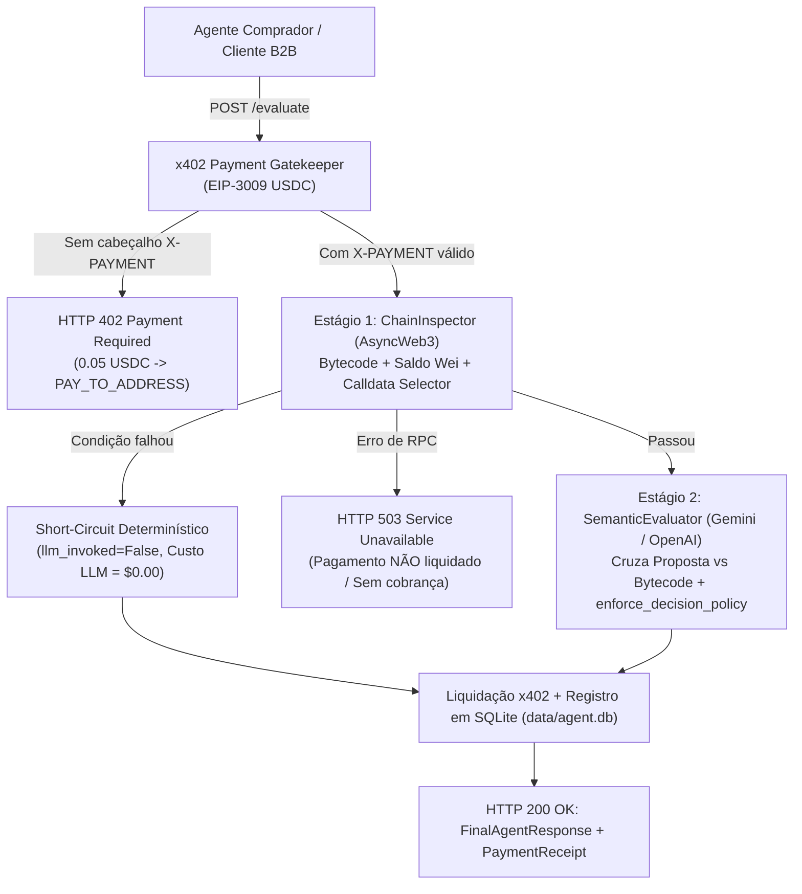

# Web3 Condition-Action Trigger Agent (x402 A2A + Hybrid LLM Auditor)

Agente autônomo Web3 com pipeline híbrido em **dois estágios** (filtragem determinística on-chain a custo zero + auditoria semântica por LLM) e monetização **Agente-para-Agente (A2A)** nativa via protocolo **x402 (EIP-3009 Gasless USDC)** na rede **Base**.

---

## 🌐 Live API (Produção no Render)

O serviço está operando em produção no [Render.com](https://render.com) empacotado via Docker:

* **Endpoint Base:** [`https://web3-systemic-agent.onrender.com`](https://web3-systemic-agent.onrender.com)
* **Preço por Avaliação Semântica:** `0.05 USDC`
* **Rede Padrão:** Base Sepolia (`eip155:84532`)
* **Contrato USDC:** `0x036CbD53842c5426634e7929541eC2318f3dCF7e`

### Endpoints Públicos Disponíveis

| Método | Rota | Descrição | Requer x402 |
| :--- | :--- | :--- | :--- |
| `GET` | `/` | Service discovery, metadata e especificações de pagamento | Não |
| `GET` | `/health` | Healthcheck de conectividade e status dos componentes | Não |
| `POST` | `/rules/validate` | Validação estática determinística da estrutura de regras | Não |
| `POST` | `/evaluate` | Pipeline híbrido completo (Determinístico + Semântico Gemini) | **Sim (0.05 USDC)** |
| `POST` | `/rules/evaluate-batch` | Avaliação síncrona em lote de múltiplas regras | Não |
| `POST` | `/rules/enqueue` | Enfileiramento de avaliação assíncrona com retorno de `job_id` | Não |
| `GET` | `/jobs/{job_id}` | Consulta de status e resultado de jobs assíncronos | Não |

> **Nota de Segurança:** Em modo público (`PUBLIC_EVALUATE_ONLY=true`), a documentação interativa (`/docs`, `/redoc`, `/openapi.json`) e rotas administrativas internas ficam desabilitadas para clientes não autenticados. O acesso administrativo pode ser habilitado via variável `ADMIN_API_KEY` utilizando o cabeçalho `X-Admin-Api-Key`.

---

## 🔗 Provas de Liquidação Real On-Chain (Base Sepolia)

O ciclo de pagamento Agente-para-Agente via **x402 EIP-3009 (`transferWithAuthorization`)** foi validado e liquidado publicamente na blockchain **Base Sepolia (Chain ID: `84532`)** sem consumo de ETH de gás pelo comprador nem pelo servidor de auditoria:

| Parâmetro | Transação 1 (Liquidação Direta) | Transação 2 (Captura On-Chain ao Vivo) | Transação 3 (Produção Render.com) |
| :--- | :--- | :--- | :--- |
| **Transaction Hash** | [`0xa02872819cef...`](https://sepolia.basescan.org/tx/0xa02872819cef168637efe50d917441fd196cd03b4baafc7b9ff3dc624f18fc0d) | [`0x6aa7c671469d...`](https://sepolia.basescan.org/tx/0x6aa7c671469d2d9a2e0a8eb3682d285394795a2da369573214f7eaad6759b647) | [`0x63ea962e6f0d...`](https://sepolia.basescan.org/tx/0x63ea962e6f0d83b73116cfc4f084b6f9495c47fa020f8db703508b5fbd06e6b5) |
| **Método / Origem** | Chamada EIP-3009 direta | Captura mempool/bloco ao vivo | `POST https://web3-systemic-agent.onrender.com/evaluate` |
| **Status On-Chain** | `Success` (Bloco `54583500`) | `Success` (Bloco `54644484`) | `Success` |
| **Carteira do Agente (`PAY_TO_ADDRESS`)** | [`0x2b7F1fd931...`](https://sepolia.basescan.org/address/0x2b7F1fd931f7f28f89e0f688Dd5Bb7a620c24b63#tokentxns) | [`0x2b7F1fd931...`](https://sepolia.basescan.org/address/0x2b7F1fd931f7f28f89e0f688Dd5Bb7a620c24b63#tokentxns) | [`0x2b7F1fd931...`](https://sepolia.basescan.org/address/0x2b7F1fd931f7f28f89e0f688Dd5Bb7a620c24b63#tokentxns) |
| **Carteira Compradora (Agente A2A)** | [`0x4EbC7529d8...`](https://sepolia.basescan.org/address/0x4EbC7529d8c948ed1245A8106F2834969dbCec2b#tokentxns) | [`0x4EbC7529d8...`](https://sepolia.basescan.org/address/0x4EbC7529d8c948ed1245A8106F2834969dbCec2b#tokentxns) | [`0x4EbC7529d8...`](https://sepolia.basescan.org/address/0x4EbC7529d8c948ed1245A8106F2834969dbCec2b#tokentxns) |
| **Facilitador x402 (Patrocinador de Gás)** | [`0xd407e409E3...`](https://sepolia.basescan.org/address/0xd407e409E34E0b9afb99EcCeb609bDbcD5e7f1bf) (`https://x402.org/facilitator`) | [`0xd407e409E3...`](https://sepolia.basescan.org/address/0xd407e409E34E0b9afb99EcCeb609bDbcD5e7f1bf) (`https://x402.org/facilitator`) | [`0xd407e409E3...`](https://sepolia.basescan.org/address/0xd407e409E34E0b9afb99EcCeb609bDbcD5e7f1bf) (`https://x402.org/facilitator`) |
| **Contrato Oficial USDC** | [`0x036CbD5384...`](https://sepolia.basescan.org/token/0x036CbD53842c5426634e7929541eC2318f3dCF7e) | [`0x036CbD5384...`](https://sepolia.basescan.org/token/0x036CbD53842c5426634e7929541eC2318f3dCF7e) | [`0x036CbD5384...`](https://sepolia.basescan.org/token/0x036CbD53842c5426634e7929541eC2318f3dCF7e) |
| **Valor Liquidado** | `0.01 USDC` | `0.01 USDC` | `0.05 USDC` |
| **Custo de Gás Comprador / Servidor** | `0.00 ETH` (Gasless EIP-3009) | `0.00 ETH` (Gasless EIP-3009) | `0.00 ETH` (Gasless EIP-3009) |

---

## 🏗️ Arquitetura em Dois Estágios + x402 Gatekeeper



---

## 📂 Estrutura do Repositório

* `src/schemas.py` — Contratos Pydantic v2 (`ConditionRulePayload`, `DeterministicResult`, `LLMAuditOutput`, `SemanticAuditResult`, `PaymentReceipt`, `FinalAgentResponse`).
* `src/chain_inspector.py` — Estágio 1 determinístico via `AsyncWeb3` com cache FIFO isolado por Chain ID e fallback automático de múltiplos RPCs.
* `src/semantic_evaluator.py` — Estágio 2 semântico (`GeminiSemanticEvaluator` com `gemini-3.5-flash-lite`, `OpenAISemanticEvaluator`, `MockSemanticEvaluator`), política determinística `enforce_decision_policy`, cap de 32k caracteres e telemetria de custos.
* `src/x402_payment.py` — Integração do protocolo x402 (`X402Config`, perfis `NETWORK_PROFILES` para Base Sepolia/Mainnet e Arbitrum One, `MockX402Facilitator`, `HTTPX402Facilitator`, parsing JSON/Base64 e proteção anti-replay).
* `src/governance_connector.py` — Conector de governança de DAOs (`SnapshotGovernanceConnector`, `WebhookAlertDispatcher` para Discord/Slack, endpoint de auditoria e extração automática de contratos/calldata).
* `src/storage.py` — Persistência assíncrona em SQLite (`data/agent.db`) com tabelas `evaluations`, `error_log` e `payments`, além de redação automática de segredos (`redact_secrets`).
* `src/task_worker.py` — Worker pool assíncrono em memória com TTL (1h) e capacidade máxima limitada.
* `src/engine.py` — Orquestrador central `ConditionAgentEngine`.
* `src/api.py` / `api.py` — Servidor HTTP FastAPI com gatekeeper x402 e controle de exposição pública.
* `src/report.py` — Relatório CLI de telemetria de tokens, custos de IA, receita x402 e lucro líquido.
* `Dockerfile` / `docker-compose.yml` / `.dockerignore` / `.env.example` — Containerização pronta para produção 24/7 (usuário não-root `appuser`, volume persistente para banco SQLite e healthcheck ativo).
* `requirements.txt` & `requirements-dev.txt` — Dependências do core em produção e ferramentas de desenvolvimento/testes.
* `scripts/` — Scripts operacionais e clientes executáveis:
  * `scripts/client_agent_x402.py` — Cliente A2A com suporte a servidores locais e remotos (`--url`), captura de transações on-chain ao vivo (`--fetch-live-tx`) e liquidação real via facilitador (`--live-onchain`).
  * `scripts/governance_listener.py` — Bot sentinela de governança de DAOs via Snapshot GraphQL API com despacho de alertas ricos via webhook.
  * `scripts/setup_buyer_wallet.py` — Inspeciona ou gera a carteira compradora de teste e consulta saldos de ETH/USDC na Base Sepolia.
* `tests/` — Suíte de testes automatizados unitários, de segurança, concorrência e integração.

---

## ⚙️ Instalação e Configuração

### 1. Clonar e Instalar Dependências

```bash
git clone https://github.com/your-username/web3-condition-action-trigger-agent.git
cd web3-condition-action-trigger-agent

# Instalação das dependências com ambiente de testes/desenvolvimento
pip install -r requirements-dev.txt
```

### 2. Configurar o Arquivo `.env`

Copie o modelo de configuração e preencha as credenciais:
```bash
cp .env.example .env
```

Exemplo para **Base Sepolia (Testnet / Staging)**:
```env
PORT=8000
GEMINI_API_KEY=sua_chave_gemini_aqui
GEMINI_MODEL=gemini-3.5-flash-lite
PAY_TO_ADDRESS=0x2b7F1fd931f7f28f89e0f688Dd5Bb7a620c24b63
X402_ENABLED=true
X402_NETWORK=eip155:84532
X402_PRICE_EVALUATE=0.05
X402_USE_LIVE_FACILITATOR=true
PUBLIC_EVALUATE_ONLY=true
ADMIN_API_KEY=
PUBLIC_API_URL=https://web3-systemic-agent.onrender.com
ALERT_WEBHOOK_URL=
```

---

## 🚀 Execução e Operação

### Executar a API Localmente

```bash
uvicorn api:app --port 8000 --reload
```

### Executar via Docker Compose

```bash
docker compose up --build
```

### Executar a Suíte de Testes

```bash
pytest
```

### Implantação no Render.com (Docker Runtime)

O repositório já inclui [`Dockerfile`](Dockerfile) otimizado com execução não-root e healthcheck integrado. Ao criar um novo Web Service no Render:

1. Conecte o repositório GitHub.
2. Selecione o runtime **Docker**.
3. Configure as variáveis de ambiente no painel do Render:
   * `PORT=8000`
   * `X402_NETWORK=eip155:84532`
   * `X402_PRICE_EVALUATE=0.05`
   * `X402_ENABLED=true`
   * `X402_USE_LIVE_FACILITATOR=true`
   * `PUBLIC_EVALUATE_ONLY=true`
   * `PAY_TO_ADDRESS=0x...`
   * `GEMINI_API_KEY=AIza...`
   * `GEMINI_MODEL=gemini-3.5-flash-lite`

---

## 🤖 Cliente Autônomo A2A (`scripts/client_agent_x402.py`)

O cliente autônomo executa o fluxo completo Agente-para-Agente com pagamento via EIP-3009 Gasless USDC:

```bash
# Execução contra a API pública em produção no Render com liquidação on-chain real:
python scripts/client_agent_x402.py --url https://web3-systemic-agent.onrender.com --live-onchain

# Execução contra servidor local em modo simulação:
python scripts/client_agent_x402.py --url http://127.0.0.1:8000

# Capturar transação ao vivo da Base Sepolia, auditar e liquidar:
python scripts/client_agent_x402.py --url https://web3-systemic-agent.onrender.com --fetch-live-tx --live-onchain
```

### DAO Governance Sentinel Bot (`scripts/governance_listener.py`)

Monitora propostas em tempo real no Snapshot e dispara alertas em canais de mensageria:

```bash
python scripts/governance_listener.py --limit 3 --webhook-url "https://discord.com/api/webhooks/..." --public-url "https://web3-systemic-agent.onrender.com" --min-alert-level WARNING
```

### Relatório Consolidado de Custos e Receita

```bash
python -m src.report
```

---

## 🧪 Suíte de Testes Automatizados

O repositório conta com uma suíte de testes automatizados cobrindo testes unitários, testes de contrato e integração, validação de segurança e concorrência:

```bash
pytest -v
```

---

## 📄 Licença

Este código está sob a **[PolyForm Noncommercial License 1.0.0](LICENSE)**.

* **Usos Permitidos:** Uso pessoal, estudo, pesquisa e organizações sem fins lucrativos são permitidos.
* **Restrições:** **Qualquer uso comercial (incluindo hospedar o serviço, revender, ou incorporar em produto pago) é proibido** sem licença comercial separada do autor.
* **Contato Comercial:** Para aquisição de licença comercial ou esclarecimentos, entre em contato via https://github.com/RafaCoelho33.

